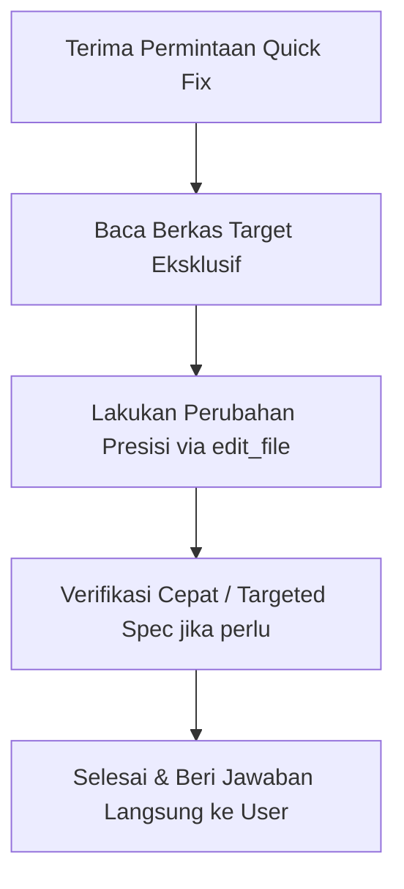

# Quick Fix & Solo Patch Skill

Skill ini menetapkan mode perbaikan cepat dan terarah untuk perubahan minor, bugfix spesifik, penyelarasan UI/UX, dan refaktor kecil tanpa overhead proses yang memakan waktu.

---

## 1. Prinsip Utama (Core Principles)

1. **Mode Eksekusi Murni Solo Routine**:
   - **DILARANG KERAS** memanggil subagent (`invoke_subagent`, `DeepCoder`, atau `DeepInvestigator`).
   - Agen utama wajib mengeksekusi analisis, modifikasi berkas, dan verifikasi secara mandiri.

2. **Tanpa Planning Mode (Zero-Ceremony Execution)**:
   - **DILARANG** membuat artefak `implementation_plan.md` atau menghentikan giliran untuk meminta konfirmasi/persetujuan plan.
   - Langsung lakukan pembacaan (*inspect*) file target dan eksekusi pengeditan (*edit_file* / *write_file*) pada giliran pertama.

3. **Tanpa Full Test Suite yang Lambat**:
   - **DILARANG** menjalankan tes menyeluruh seluruh workspace (seperti `nx test web --skip-nx-cache` atau `go test ./...` penuh yang memakan waktu lama).
   - Gunakan hanya targeted verification jika diperlukan:
     - Syntax check atau targeted unit test file (misal: `npx jest path/to/file.spec.ts` atau `go test -v ./internal/target_pkg -run TestSpecificFunction`).
     - Linter terarah pada berkas yang dimodifikasi.

4. **Fokus 1 Turn Selesai (Fast Turnaround)**:
   - Tuntaskan seluruh perubahan kode dan verifikasi esensial dalam 1 giliran percakapan.
   - Berikan laporan respons akhir yang lugas, jelas, dan solutif dalam Bahasa Indonesia baku tanpa bertele-tele dan tanpa karakter em dash (`—`).

---

## 2. Alur Kerja (Workflow)

1. **Identifikasi Berkas Target**:
   - Gunakan `read_file` pada berkas yang relevan langsung ke baris kode yang dituju.
2. **Terapkan Patch Langsung**:
   - Terapkan perubahan terkecil yang menyelesaikan masalah secara tepat (*ponytail approach*).
3. **Targeted Verification (Opsional & Cepat)**:
   - Jika berkas memiliki test spec yang berkaitan langsung, jalankan hanya test spec tersebut.
4. **Respon Akhir**:
   - Jelaskan baris berkas yang diubah dan dampaknya secara langsung tanpa membuat dokumen berlebih.

